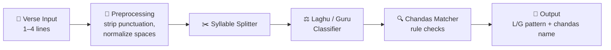

# 🕉️ Chandas Anveshana
### *Chandas Detector using Chandashastra*

> Paste a Sanskrit verse. Get its syllables, its Laghu–Guru pattern, and its chandas (meter) in one click.

🏆 **2nd Prize Winner: Department-Level Hackathon**

---

## 📜 Problem Statement

Pragnanda, a student of ancient Indian literature, finds a poetic verse inscribed on a sculpture. He wants to know its **chandas (meter)** using the rules of **Chandashastra**, the system formalized by **Pingala**.

Doing this by hand is slow and error-prone. You have to break the verse into syllables, decide whether each one is **Laghu (short)** or **Guru (long)**, and then compare the pattern against known meters.

**The task:** build a program that takes a verse, finds its syllables, generates the Laghu–Guru (L/G) pattern, and matches it to a limited set of supported chandas.

**Supported chandas**

| Chandas | Syllables per pāda | Rule |
|---|---|---|
| **Anushtubh** (Anuṣṭup) | 8 | 5th syllable **L**, 6th **G**, 7th alternates **G / L** between pādas |
| **Indravajrā** | 11 | 1, 2, 4, 5, 8, 10, 11 are **G**, the rest **L**. Pause after the 5th and last syllable |
| **Upendravajrā** | 11 | Same as Indravajrā, but the **1st syllable is L** |

If nothing matches, the output is **`Unknown`**.

---

## 💡 Solution

**Chandas Anveshana** ("Chandas Investigation") is a web-based meter detector. It follows the exact three-step flow from the problem statement:

1. **Split** the verse into syllables
2. **Classify** each syllable as Laghu (L) or Guru (G)
3. **Match** the pattern against the rules of the supported chandas

The result is a clear, readable breakdown (syllables → L/G pattern → detected chandas) that anyone can check against the rules.

---

## ✨ Features

- ✅ Accepts a **1–4 line verse** in Sanskrit or transliterated text
- ✅ **Ignores punctuation** and **handles extra spaces**
- ✅ **Syllable splitting** for transliterated Sanskrit
- ✅ **Laghu / Guru identification** using Chandashastra rules
- ✅ Shows the **L/G pattern** for every line (pāda)
- ✅ **Rule checking** for Anushtubh, Indravajrā and Upendravajrā
- ✅ Returns **`Unknown`** when no supported chandas fits
- ✅ **Runs in the browser**, with no backend and no install

---

## 🛠️ Tech Stack

| Layer | Technology |
|---|---|
| Markup | HTML5 |
| Styling | CSS3 |
| Logic | JavaScript (client-side) |
| Hosting / CI | GitHub + GitHub Actions |

---

## 🏗️ System Architecture



| Module | Responsibility |
|---|---|
| **Input handler** | Reads the verse, removes punctuation, collapses extra spaces |
| **Syllable splitter** | Breaks each word into syllables (one vowel nucleus per syllable) |
| **Laghu–Guru classifier** | Assigns **L** or **G** to every syllable |
| **Chandas matcher** | Compares each pāda's pattern with the supported meter rules |
| **Output renderer** | Displays syllables, the pattern and the detected chandas |

---

## ⚙️ How It Works

### Step 1: Clean the input
Punctuation is removed and extra whitespace is collapsed, so `"Vasudeva   sutam, devam!"` becomes `vasudeva sutam devam`.

### Step 2: Split into syllables
```
vasudeva sutam devam   →   va su de va | su tam de vam
```

### Step 3: Mark Laghu (L) and Guru (G)

A syllable is **Guru (G)** if:
- its vowel is **long** (`aa`, `ii`, `uu`, `e`, `ai`, `o`, `au`), **or**
- its vowel is followed by a **conjunct consonant** (two or more consonants), **or**
- it ends in an **anusvāra (ṃ/m)** or **visarga (ḥ)**

Otherwise it is **Laghu (L)**.

```
va su de va | su tam de vam
L  G  G  L    L  G   G  G
```

### Step 4: Match the chandas

| Check | Condition |
|---|---|
| **Anushtubh** | 8 syllables per pāda, 5th = L, 6th = G, 7th alternates G/L |
| **Indravajrā** | `G G L G G L L G L G G` |
| **Upendravajrā** | `L G L G G L L G L G G` |
| **Anything else** | `Unknown` |

### 🧪 Examples

| Input | L/G pattern | Detected |
|---|---|---|
| `Vasudeva sutam devam / kamsa chanura mardanam` | `L G G L L G G G` / `G L L L L G L G` | **Anushtubh** |
| `syaad indravajraa yadi tau jage gah` | `G G L G G \| L L G L G G` | **Indravajrā** |
| `upendravajraa prathamam laghu saa` | `L G L G G \| L L G L G G` | **Upendravajrā** |

---

## 🚀 Run It Locally

```bash
git clone https://github.com/vedamurthym/chandas-anveshana.git
cd chandas-anveshana
# open index.html in your browser, no build step needed
```

---

## 🔮 Future Scope

- 📚 Support more chandas such as **Vasantatilakā, Mandākrāntā, Śārdūlavikrīḍita** and **Āryā**
- 🔤 Accept **Devanagari script** directly, plus IAST / Harvard-Kyoto / ITRANS input
- 🧠 Handle **partial or noisy verses** with a "closest match" suggestion
- 🔊 Add **audio recitation** with the correct rhythm (pauses / yati)
- 🧾 Add a **visual rhythm chart**, highlighting the L/G pattern pāda by pāda
- 🤖 Use **ML / OCR** to read verses straight from photos of inscriptions and manuscripts
- 📱 Ship as a **PWA / mobile app** for students and scholars

---

## 🏆 Hackathon Achievement

**🥈 2nd Prize: Department-Level Hackathon**

Built under the problem statement *"Chandas Detector using Chandashastra"*, and judged on **input handling, syllable detection, Laghu–Guru identification, rule checking and output format**.

---

## 👨‍💻 Author

**Vedamurthy M**
Student, VTU (AI & Applications) · Aspiring AI/ML Engineer
GitHub: [@vedamurthym](https://github.com/vedamurthym)

---

⭐ If you like this project, give it a star!
